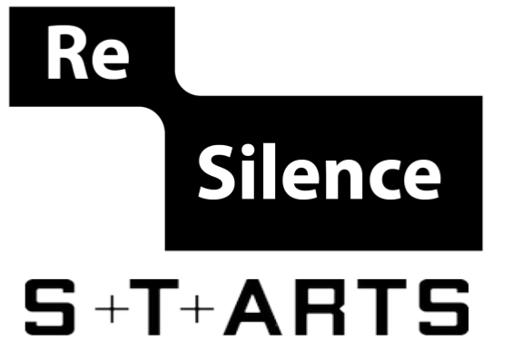

# PyEyesWeb

[](https://infomuscp.github.io/PyEyesWeb/)
[](LICENSE.txt)

PyEyesWeb is a research toolkit for the quantitative analysis of expressive movement. It is a Python layer over a port of the
Expressive Gesture Analysis library of [EyesWeb](https://casapaganini.unige.it/eyesweb_bp), with features organised in layers
that follow a conceptual model of movement: from physical signals, through low-level and mid-level features, to the
analysis of several people together. Every feature obeys one call contract and one result type, so the same code runs on a
live stream and on a recorded file.

## Installation

PyEyesWeb 2.0 is a **pre-release** and is **not on PyPI yet**: the latest release on PyPI is 1.x, which has a different API
(see [Migrating from 1.x](https://infomuscp.github.io/PyEyesWeb/migration.html)). At release the installation will be

```bash
pip install pyeyesweb
```

which also installs the compiled core, the separate `eyesweb-core` wheel (Python 3.10 or later).
Until then, build the core from its sources and install PyEyesWeb from a clone, pointing `EYESWEB_CORE_PATH` at the folder
that contains the built `eyesweb_core` module:

```bash
git clone https://github.com/InfoMusCP/PyEyesWeb.git
cd PyEyesWeb
pip install -e .[dev]
export EYESWEB_CORE_PATH=/path/to/eyesweb_core/build   # PowerShell: $env:EYESWEB_CORE_PATH = "..."
```

## Example

Synthetic data only; the output in the comments is the output of this script.

```python
import numpy as np
from pyeyesweb.low_level import SpectralArcLength

rate = 100.0                                              # samples per second
time = np.arange(300) / rate                              # seconds
speed = 0.6 * np.exp(-0.5 * ((time - 1.5) / 0.4) ** 2)    # one smooth reach, m/s

feature = SpectralArcLength(window=100, sampling_rate=rate)
recording = feature.run(speed, timestamps=time)           # a whole recording gives a Recorder
print(recording)
# Recorder(SpectralArcLength, rows=300, columns=['spectral_arc_length'], status={'OK': 201, 'WARMING_UP': 99})
print(recording[-1])                                      # a row is a Result
# SpectralArcLengthResult(status=OK, spectral_arc_length=-1.63417)
feature.reset()                                           # streaming: one sample per call
print(feature.process(speed[0], timestamp=time[0]))
# SpectralArcLengthResult(status=WARMING_UP, reason='1 of 100 samples', spectral_arc_length=nan)
```

## Documentation

The [documentation](https://infomuscp.github.io/PyEyesWeb/) has a quickstart, the concepts (layers, inputs, results, time and
units), the theory of each family of features with references, a user guide per layer and the API reference.
The [gallery of tutorials](https://infomuscp.github.io/PyEyesWeb/tutorials/index.html) is a set of executed examples, each
downloadable as a notebook. The [catalog](https://infomuscp.github.io/PyEyesWeb/api/catalog.html) lists every feature with its
layer, inputs, outputs and parameters.

## Layers

`pyeyesweb.catalog()` returns the 60 features of this release:

| Layer | Package | Features |
|---|---|---|
| Physical signals | `pyeyesweb.physical_signals` | 11 |
| Low-level features | `pyeyesweb.low_level` | 22 |
| Mid-level features | `pyeyesweb.mid_level` | 7 |
| High-level features | `pyeyesweb.high_level` | 1 |
| Analysis primitives | `pyeyesweb.analysis_primitives` | 19 |

## Support and contributing

Report bugs and ask questions on [GitHub Issues](https://github.com/infomuscp/PyEyesWeb/issues) or
[Discussions](https://github.com/infomuscp/PyEyesWeb/discussions), or write to `cp.infomus@gmail.com`. Contributions are
welcome: see [CONTRIBUTING](.github/CONTRIBUTING.md) and the development specification (`DEVELOPMENT_SPEC.md`).

## Citation

If you use PyEyesWeb, please cite (the metadata is in [`CITATION.cff`](CITATION.cff)):

> S. R. Sabharwal, N. Corbellini, S. Ghisio, P. Coletta, G. Romano, A. Al Foysal, G. Volpe and A. Camurri.
> PyEyesWeb: An open source toolkit for multimodal movement feature extraction. In *MOCO '26: Proceedings of the 10th
> International Conference on Movement and Computing*, Montpellier, France, 23-25 April 2026. ACM, New York, NY, USA.
> doi:[10.1145/3802842.3802904](https://doi.org/10.1145/3802842.3802904)

## Authors and acknowledgments

PyEyesWeb is developed by [InfoMus Lab - Casa Paganini](http://www.casapaganini.org/index_eng.php), University of Genoa, with the
partial support of the [EU ICT STARTS Resilence Project](https://www.resilence.eu/).

<div align="center">

</div>
<div align="center">


</div>

## License

MIT License, see [LICENSE.txt](LICENSE.txt).
